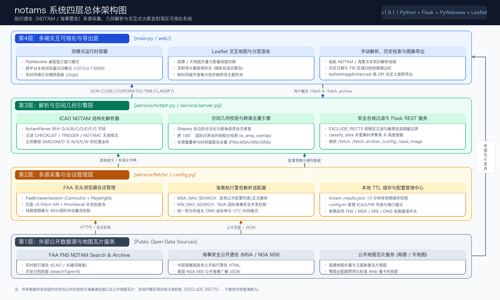

# notams（航行通告火箭发射落区解析与可视化工具）

[](LICENSE)
[](requirements.txt)

基于公开民航航行通告（ICAO NOTAM）与海事航行警告（MSA / NGA MSI）的多源自动采集、坐标解析、空间去重与交互式地图可视化工具，面向商业航天发射窗口研判与科普观测场景。

> **免责与合规声明**：本项目所处理数据均来源于国内外民航、海事官方门户依法公开发布的航行通告与航行警告，内置区域合规过滤机制，不接入未公开或涉密数据源，亦不提供任何敏感目标或火箭型号自动识别功能。

---

## 一、背景介绍：NOTAM 与火箭发射落区

随着商业航天与发射任务的常态化，公众与航天爱好者常通过分析官方发布的民航飞行航行通告（NOTAM）及海事航行警告，提前了解火箭发射窗口及残骸落区范围。典型发射落区 NOTAM 报文如下：

```text
A1690/23 - A TEMPORARY DANGER AREA ESTABLISHED BOUNDED BY: N392852E0955438-N385637E0955854-N390118E0970056-N393335E0965708 BACK TO START. VERTICAL LIMITS:SFC-UNL. SFC - UNL, 06 JUL 03:18 2023 UNTIL 06 JUL 04:45 2023. CREATED: 05 JUL 07:40 2023
```

其中 `A1690/23` 为航警编号，`N392852E0955438-...` 为落区多边形顶点经纬度，`06 JUL 03:18 2023 UNTIL 06 JUL 04:45 2023` 为生效时间窗。手动逐条检索各国各情报区（FIR）报文并换算绘制极为繁琐，本项目旨在将上述流程自动化、图形化、开源化。

---

## 二、核心功能

1. **多源公开航行通告自动采集与增量缓存**
   - 支持 **FAA FNS NOTAM Search**（基于 Camoufox 无头会话与浏览器内 `Promise.all` 并发批查询，全量抓取耗时约 21.4s）、**中国海事局（MSA）政务公开航警** 与 **NGA MSI 国际海事警告**；
   - 支持实时检索与历史日期/FIR 归档检索，内置 10 分钟本地 TTL 缓存控制。
2. **多格式报文解析与跨源空间去重**
   - 兼容 DMS / DM / D 及南北西东半球前后置坐标格式，支持解析高度限（`Q)`/`F)`/`G)` 米制换算）；
   - 基于 `Shapely` 修复多边形自交与跨 180° 国际日界线相交检测，按时空重叠率自动完成跨数据源去重（优先级 `FNS > MSA > MSI > DINS`）；
   - 通过时序并查集对同一发射窗口的关联落区自动聚类着色。
3. **交互式地图可视化与多发射场标注**
   - 基于开源 **Leaflet v1.9.4** 渲染落区，支持高德地图/天地图的矢量与卫星影像图层切换，并随底图自动切换高对比度颜色池；
   - 内置我国发射场与着陆场（酒泉、太原、西昌、文昌、海阳等）缩放自适应标记，支持右侧侧边栏联动定位与列表高亮。
4. **手动离线解析绘制与高 DPI 图像导出**
   - 侧边栏支持直接粘贴任意 NOTAM 或海警文本实时解析绘制（无需联网即可完成核心算法验证）；
   - 内置增强版 `leaflet-image` 导出器，支持“当前视图 / 全落区 / 自定义框选区域”及 x1–x4 倍率高清 PNG/JPEG 导出。

---

## 三、系统架构



项目采用前后端分离与双模式运行时设计：
- **入口与容器**：`main.py` 启动多线程 `Flask` 服务，支持本地浏览器模式与 `PyWebview` 独立桌面窗口模式；
- **后端核心（`service/`）**：`service/fetch/` 负责多源采集适配器与会话管理，`service/notam.py` 与 `service/server.py` 负责报文解析、几何计算、区域过滤与 REST API；
- **前端交互（`web/`）**：原生 HTML/CSS/JS 结合 `Leaflet` 完成图层渲染、历史检索、手动输入及高 DPI 导出。

---

## 四、快速开始

### 1. 源码部署

```bash
# 华中科技大学校内 Git 主仓库（推荐校内访问）
git clone https://git.hust.edu.cn/U202311386/notams.git
# 或 GitHub 公开镜像仓库
# git clone https://github.com/FallingFengre/notams.git
cd notams
pip install -r requirements.txt
python3 -m camoufox fetch   # 首次使用 FAA 在线抓取需下载 Camoufox 无头内核
python3 main.py
```

启动后默认可在浏览器访问 `http://127.0.0.1:5000`（可在 `config.ini` 中修改端口与桌面窗口模式）。详细安装配置、离线验证样例与跨平台说明请参阅 **[安装与使用文档](docs/INSTALL.md)**。

### 2. Windows 预编译版本

- [GitHub Releases (v1.4 ~ v1.9)](https://github.com/FallingFengre/notams/releases)
- [蓝奏云网盘分流](https://wwpj.lanzoul.com/notams)

---

## 五、开源文档导航

| 文档类型 | 文件路径 | 说明 |
|---|---|---|
| 开源许可证 | [LICENSE](LICENSE) | 本项目采用 **MIT License** |
| 安装与使用文档 | [docs/INSTALL.md](docs/INSTALL.md) | 环境要求、安装命令、`config.ini` 参数、离线测试样例与跨平台说明 |
| 版本更新记录 | [CHANGELOG.md](CHANGELOG.md) | `v1.4` ~ `v1.9.1` 完整发布历史与近期维护记录 |
| 问题处理记录 | [docs/ISSUES_SUMMARY.md](docs/ISSUES_SUMMARY.md) | 社区 Issue 台账与重大工程缺陷闭环说明 |
| 贡献指南 | [CONTRIBUTING.md](CONTRIBUTING.md) | 目录架构、提交规范、测试步骤与安全合规准则 |

---

## 六、相关社区文章

- [B 站专栏介绍](https://www.bilibili.com/opus/1005673245294198789)
- [百度贴吧发布帖](https://tieba.baidu.com/p/9298301903)

---

## 七、第三方开源依赖与许可声明

本项目遵守各第三方开源组件许可协议，主要依赖如下：

| 组件/库 | 用途 | 开源许可证 |
|---|---|---|
| [Leaflet v1.9.4](https://leafletjs.com/) | 前端交互地图核心库（源码内置于 `web/static/leaflet/`） | BSD 2-Clause License（见 `web/static/leaflet/LICENSE`） |
| [Flask](https://flask.palletsprojects.com/) | 后端轻量级 Web 服务与 API 路由 | BSD 3-Clause License |
| [PyWebview](https://pywebview.flowrl.com/) | 跨平台独立桌面窗口容器 | BSD 3-Clause License |
| [Shapely](https://shapely.readthedocs.io/) | 地理多边形合法化、自交修复与空间相交运算 | BSD 3-Clause License |
| [Camoufox](https://camoufox.com/) / [Playwright](https://playwright.dev/) | 无头浏览器会话管理与并发网页 Fetch 调度 | MIT / Apache-2.0 License |
| [Requests](https://requests.readthedocs.io/) / [BeautifulSoup4](https://www.crummy.com/software/BeautifulSoup/) | 公开海事通告 HTML/JSON 请求与解析 | Apache-2.0 / MIT License |
| [NumPy](https://numpy.org/) / [Pandas](https://pandas.pydata.org/) / [Pillow](https://python-pillow.org/) | 数据去重清洗与导出图像处理 | BSD 3-Clause / HPND License |

---

## 八、作者与致谢 (Authors & Acknowledgment)

- **核心维护与参赛团队**：
  - `FallingFengre`（Junye Liu）：项目发起人与早期主作者，负责整体架构、多源采集解析与 `v1.4`~`v1.9` 版本发布；
  - `xin700`（Rongxin Liu）：负责动态网页无头会话采集重构、并发性能优化、开源合规文档体系建设与校内维护。
- **社区贡献者**：感谢 `festoney8`（模块化拆分与 `NotamParser`）、`Joey0609`（时序着色、重试弹窗与图像导出）与 `NearlyHeadlessJack`（依赖与运行说明整理）对本项目的代码贡献。

---

## 九、项目状态与演进路线图 (Project Status & Roadmap)

- **当前状态**：项目处于积极维护阶段（最新规范化版本 `v1.9.1`），日常围绕上游接口兼容性与离线解析准确率进行持续维护。
- **后续规划**（完整清单见 [TODOList](TODOList)）：
  - 前端可视化设置面板（支持自定义图标显隐、多边形样式及 `config.ini` 可视化编辑）；
  - 坐标拾取、距离测量工具与 KML 导出支持；
  - 落区几何特征分析与历史落区快照管理。
